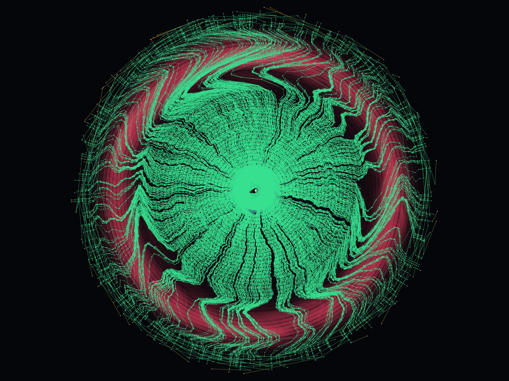

# Game trees

`game-tree.html` draws the game tree of any deal in 3D, in the browser, and lets you explore it: each dot is a position
and each line a move, and a position reached by different orders of moves is drawn once. It is one file with nothing to
install, and the part between `<!-- acc-tree` and `<!-- end of acc-tree -->` can be pasted into a blog post as it is.



## Opening it

Open `game-tree.html` in Chrome, Edge or Firefox. If the browser won't run it from a file, serve the folder:

```
python game-tree/serve.py
```

and open `http://127.0.0.1:8781/game-tree.html`. The server listens on this computer only; it also saves pictures sent
to `/save/<name>.png` into `screenshots/full/`, which is how the pictures here were made.

The page keeps its controls few: examples, a seed box (Enter draws it), Random deal, the size, Play, 3D or Top, full
screen and About. The address can choose more: `?ex=l268817008782` (an example, by the key in the page's list, including
those left out of the menu), or `?seed=123`, with `&size=1000000` (any number of positions from 1,000 to 40 million,
such as `2.5m`), `&view=top` (`3d`, `top`, `side`), and three ways of drawing that have no control on the page:
`&shape=spindle`, `&color=best` (`outcome`, `best`, `depth`) and `&edges=all` (`tree`, `all`, `none`).

## What it shows

- **Colours**, with a key always at the bottom left: green positions can still win, gold ones are won (one pile), red
  ones are lost and blue-grey ones aren't settled either way. The positions that can win, and the moves between them,
  are drawn again on top so that the few winning lines in a hard deal stand out. With `&color=best`, positions are
  coloured by the fewest piles they can get down to instead.
- **Chart**: under the deal's numbers, the positions drawn after each move (log scale, in the key's colours), with a
  place for every move up to a win, so a lost tree is seen to stop short. Point at or tap a bar for its counts; the
  selected position's move is marked under it.
- **Rings**: the deal is at the centre (the top, in 3D) and each move one ring further out, each position near the
  positions it comes from and never more than 2 units along its ring from the one whose move is drawn, so a winning
  line runs on without big jumps sideways. With `&shape=spindle` in the address, each position is placed by which cards are covered
  instead: each covered card pushes it towards that card's place in the deal, so moves that don't interfere draw as
  parallelograms.
- **Small trees are complete.** The lost deals of the trillion run have between 2 and 22,066,800 positions; a tree that
  fits the chosen size (100,000, 1 million, 4 million, 40 million, or a number typed in) is drawn with every position and
  every move, and its counts are exact. Of the 721, 701 fit in 4 million and all of them in 40 million: the biggest,
  22,066,800 positions joined by 134,505,640 moves, takes about 16 seconds and 1.7 GB.
- **How 40 million fit.** A position keeps only the move that first reached it, the card that move covered, a few flags
  and two 32-bit hashes of its row of top cards; its cards are played again from the deal when they are needed. The
  hashes are of the row's pairs of neighbouring cards, so a move changes them in a few steps, and two different
  positions share both with odds of 1 in 2<sup>64</sup>: even among 40 million the odds that any two are mixed up are
  under 1 in 10,000. A sample of 40 million positions of a deal that can be won takes about 45 seconds and 2 GB.
- **Helpers.** For a tree of 250,000 positions or more, the engine's worker starts copies of itself, one fewer than the
  processor's threads and at most 4. One lays out each depth while the search goes on, and the others find the moves
  of the positions the search comes to next. The tree comes out the same, to the last bit, as without them; where
  workers can't be made, or one fails, the rest is done without them. On a 16-thread laptop in Chrome they take the
  biggest loss from 26 to 16 seconds, the 40 million sample from 61 to 43, and the default 1 million from 1.5 to 1.3.
- **Drawing.** Every dot and line of a big tree takes the graphics card long to draw (1.6 seconds for 40 million on a
  laptop's own graphics), so while the view moves a tree over 400,000 positions is drawn from 400,000 sampled dots and
  lines, each brighter for those it stands for. Once the view is still, the whole picture is added up over a few
  frames, the last one staying on the screen, and it is the same picture to the bit.
- **Known deals.** The page knows the 721 lost deals of seeds 0 to 999,999,999,999 and their numbers of positions, so
  every other seed in that range is known to be winnable and goes straight to a sample, and a lost one is drawn whole
  when it fits.
- **Big trees are samples.** A deal that can be won usually has something like 10<sup>17</sup> positions. Then the first
  15% of the size is every position of the first few moves, and the rest comes from short searches like the solver's:
  depth first, a few thousand positions each, moves in a random order that favours leaps, never into a position the
  solver's dead-end test shows lost. Each group of searches starts from the deal, then from positions it reached, so they
  branch like a tree. In an easy deal most of them find a win; in a hard one almost none do.
- **Click a dot** to see its position as cards, the way in from the deal (white) and the best line from it (gold to a
  win, red to the fewest piles drawn). **Explore from here** draws the tree from that position, which is complete once
  it is small enough: from the 20-pile position on seed 185's way to a win, for example, all 89,801 positions, where
  4,974,472 of the 1,198,856,684 ways to play on win.
- **Play** opens the deal (or the position explored) as a game: click a card to put it on the card 1 or 3 places to its
  left with the same suit or rank. After each move the tree from your position on stays lit and the rest is dimmed, and
  your game is drawn as a white line; Hint shows the next move of the best line drawn, and Play best move plays it.
  When less than a third of a sample is lit below where you are (or your position isn't drawn), the tree is drawn again
  with your moves in, once your moves pause: a quarter of it is every position a few moves below where you have got to,
  three quarters of the short searches start there, and a winning line the last tree showed from there is kept. The top
  of the tree stays the same. A game's trees have at most 1 million positions (700,000 where few short searches win),
  so a new one comes about a second after your last move at any size, and Close brings back the tree from before the
  game. A complete tree has every position already.
- **In a blog post** the first tree is drawn when the block comes near the screen. One finger scrolls the page up and
  down, two fingers turn and zoom the tree, and the wheel scrolls the page until the tree is clicked (or with Ctrl held).
  On its own page, or full screen, every touch and the wheel drive the tree.

## The examples

The menu has eight: an easy deal (185), the first deal (0), a medium one (81), a hard one (3), a very hard one
(56669828180) and three lost ones, of 1,512, 74,970 and 3,997,296 positions. The others below load from the address
with `?ex=`.

- **Can be won**: of the first 300 deals, measured by how many of a 1 million sample's short searches win: seed 185
  wins most often (521 of 592), seed 0 is 14th (293 of 388), seed 81 is in the middle (118 of 229) and seed 3 is
  298th (38 of 173). At 100,000 positions fewer win, but the order is about the same. Then the five deals of the
  trillion run that only the exhaustive search won (after 9,983 failed tries each), with their known winning lines
  drawn in.
- **Lost**: eleven of the 721 proven losses, from the one with a single legal move (2 positions) to the one with the most
  positions (22,066,800, drawn whole at the 40 million size).

## Checking it

```
node game-tree/test-engine.mjs
```

runs the page's engine on the 51 lost deals of every size up to 700,000 positions and checks, for each, that it finds as
many positions as the proof (`research/lean/automaton/certificates.csv`), as many moves as the plain proof search
(`hard-deals/proofs/`), and the same fewest piles as the record (`hard-deals/INDEX.md`); then that the page's list of
losses is the proofs' list, that a hard deal's winning line plays and wins, and that a sampled tree's colours agree with
its moves, with a separate exhaustive search confirming the fewest piles of positions marked exact and that positions
marked lost can't win. All pass. `node game-tree/test-engine.mjs 23000000` adds bigger losses, up to the biggest (it
matches its proof's 22,066,800 positions, 134,505,640 moves and 22 piles; a few minutes and 2 GB).

## Pictures

`screenshots/` has stills of the examples, saved from the page through `serve.py` (with `host.accTree.save`, which draws
the tree at twice the size of the screen) and made into 1,600-pixel JPEGs. The full-size originals (2,304 by 1,728) stay
in `screenshots/full/`, which isn't committed.
